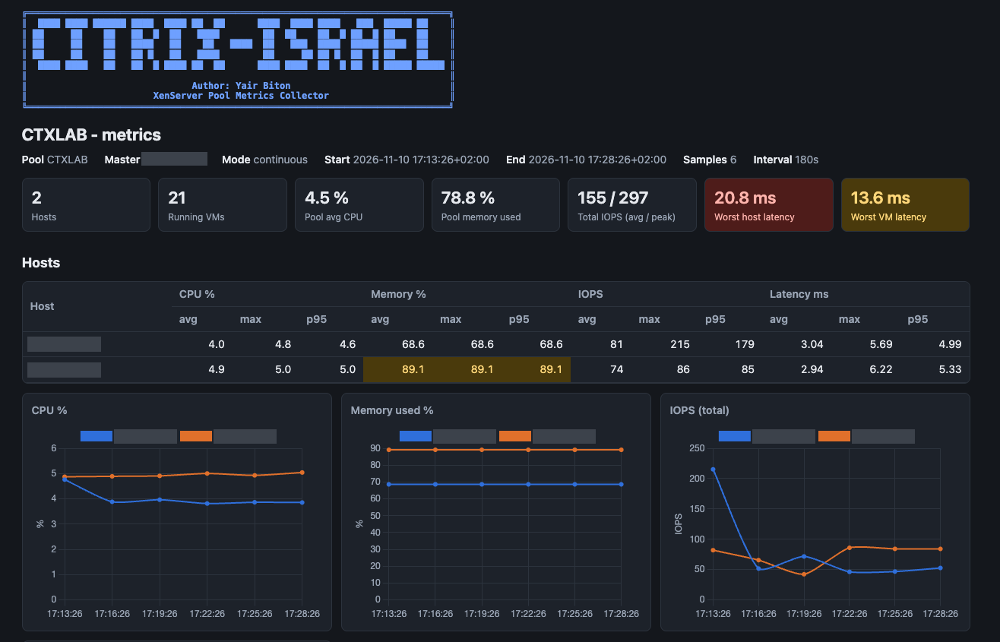
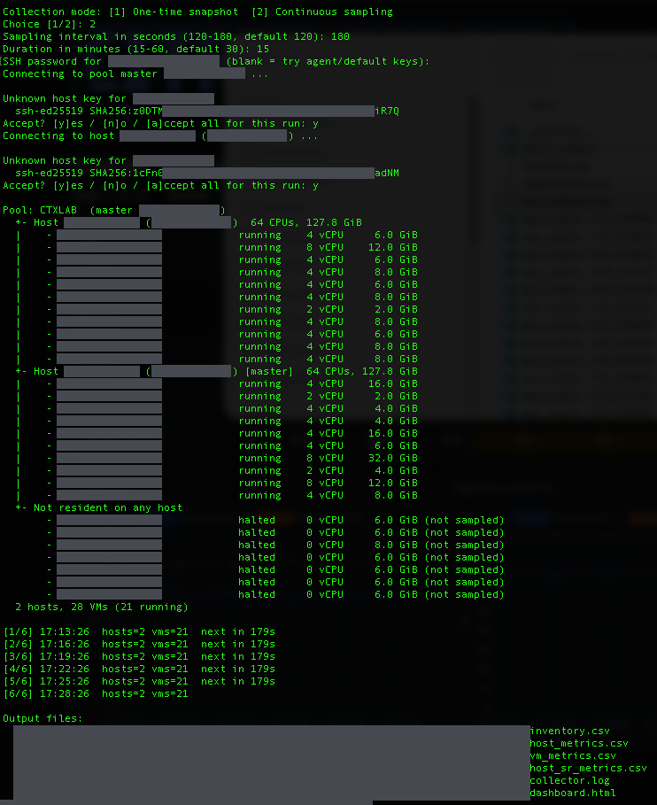

# XenServer Pool Metrics Collector

**Author: Yair Biton — CITRIX-ISRAEL**

A single Python script that connects over SSH to a XenServer / Citrix Hypervisor / XCP-ng pool, maps every host and VM, collects CPU, memory, IOPS and disk latency, saves the data to CSV files and builds an HTML dashboard.

It runs from your workstation (macOS, Linux or Windows). Nothing is installed on the XenServer hosts.

## Screenshots

The HTML dashboard built at the end of a run:



A continuous run in the terminal — the mode questions, the pool map and the sampling progress:



## What it does

1. Connects by SSH to the pool master.
2. Maps all hosts in the pool, all VMs on each host, and all storage repositories.
3. Collects CPU, memory, IOPS, throughput and disk latency for every host and every running VM.
4. Asks whether to take a one-time snapshot or to sample continuously (every 120–180 seconds, for 15–60 minutes).
5. Writes everything to CSV files, saved after every sample.
6. Builds `dashboard.html` from the CSV files and opens it in your browser.

## Requirements

- Python 3.9 or newer
- The `paramiko` package (SSH client)
- SSH access as `root` (or another user who can run `xe`) to the pool master. Access to the other pool hosts with the same credentials is recommended but not required.
- Internet access in the browser to draw the charts (Chart.js is loaded from a CDN). The summary tiles and tables work offline.

## Installation

```bash
git clone https://github.com/yairbeaton/xenserver-metrics-collector.git
cd xenserver-metrics-collector
pip3 install -r requirements.txt
```

## Quick start

Try it without a XenServer first. Demo mode generates a synthetic pool (3 hosts, 12 VMs) and produces real CSV files and a dashboard:

```bash
python3 xen_collector.py --demo --mode snapshot
```

Run it against a real pool. Pass only the address of the pool master:

```bash
python3 xen_collector.py --host 10.0.0.5
```

The script then:

1. Asks for the collection mode: `1` for a one-time snapshot, `2` for continuous sampling.
2. In continuous mode, asks for the interval (120–180 seconds, default 120) and the duration (15–60 minutes, default 30).
3. Asks for the SSH password. It is hidden while you type, kept in memory only, and never written to disk or logs.
4. Shows the SSH key fingerprint of each host it has not seen before. Answer `y` to accept one host, `a` to accept all hosts for this run, or `n` to refuse.
5. Prints the pool → host → VM tree, collects the data, and opens the dashboard.

Press `Ctrl+C` during a continuous run to stop early. The data collected so far is kept and the dashboard is still built.

## Options

| Option | Meaning |
| --- | --- |
| `--host ADDRESS` | Pool master address (address only, not `root@address`) |
| `--user NAME` | SSH user, default `root` |
| `--port N` | SSH port, default 22 |
| `--key-file PATH` | SSH private key to use instead of a password |
| `--mode snapshot\|continuous` | Skip the mode question |
| `--interval SECONDS` | Sampling interval, 120–180 (continuous mode) |
| `--duration MINUTES` | Total duration, 15–60 (continuous mode) |
| `--output-dir DIR` | Output folder, default `./xen_metrics_<date_time>` |
| `--host-latency-unit us\|ms` | Unit of the host storage latency metrics, default `us` (microseconds) |
| `--dashboard-only DIR` | Rebuild `dashboard.html` from the CSV files in `DIR` without collecting |
| `--demo` | Synthetic pool, no SSH |
| `--no-open` | Do not open the dashboard in a browser |

Anything not given on the command line is asked interactively.

## Examples

One-time snapshot with an SSH key:

```bash
python3 xen_collector.py --host 10.0.0.5 --key-file ~/.ssh/id_ed25519 --mode snapshot
```

45 minutes of sampling every 150 seconds:

```bash
python3 xen_collector.py --host 10.0.0.5 --mode continuous --interval 150 --duration 45
```

Rebuild the dashboard of an earlier run:

```bash
python3 xen_collector.py --dashboard-only ./xen_metrics_20261110_120000
```

## Output files

Each run creates a folder named `xen_metrics_<date_time>` containing:

| File | Contents |
| --- | --- |
| `inventory.csv` | Every host and VM: name, UUID, host, address, power state, vCPUs, memory |
| `host_metrics.csv` | One row per host per sample |
| `vm_metrics.csv` | One row per running VM per sample |
| `host_sr_metrics.csv` | One row per host and storage repository per sample |
| `dashboard.html` | The report |
| `collector.log` | Warnings, and the full list of metric names the pool reported |
| `run_meta.json` | Pool name, mode and interval, used when rebuilding the dashboard |

Columns in `host_metrics.csv`:

`timestamp, sample_no, host_uuid, host_name, source, cpu_pct, mem_total_gib, mem_used_gib, mem_used_pct, iops_read, iops_write, iops_total, throughput_mib_s, latency_ms_avg, latency_ms_max, read_latency_ms, write_latency_ms`

Columns in `vm_metrics.csv`:

`timestamp, sample_no, vm_uuid, vm_name, host_name, source, cpu_pct, mem_total_gib, mem_free_gib, mem_used_gib, mem_used_pct, iops_read, iops_write, iops_total, throughput_mib_s, read_latency_ms, write_latency_ms, latency_ms_max`

The `source` column shows how the values were read:

- `rrd` — from the host's RRD performance database. Values are averages over the sampling interval.
- `xe` — from `xe` data-source queries through the pool master (the fallback). Values are instantaneous readings.

## The dashboard

- Summary tiles: hosts, running VMs, pool CPU and memory, total IOPS, worst host and VM latency.
- Hosts: average, maximum and 95th percentile per host, with charts over time in continuous mode.
- Virtual machines: a sortable, filterable table of all VMs, top-10 charts by CPU, IOPS and latency, and per-VM charts over time.
- Storage repositories: IOPS and latency per host and repository.
- Cells are highlighted amber / red at CPU ≥ 75 / 90 %, memory ≥ 80 / 90 %, latency ≥ 10 / 20 ms.

## How it collects the data

- Hosts, VMs and storage repositories are mapped with `xe host-list`, `xe vm-list` and `xe sr-list` on the pool master. In continuous mode the VM map is refreshed at every sample, so migrations are followed.
- On each host, the script reads `rrd_updates` from xapi's local socket. XML and JSON responses are both understood.
- If that fails on a host, or the host cannot be reached by SSH, its metrics are read through the pool master with `xe host-data-source-query` and `xe vm-data-source-query`.
- The script only reads. It makes no changes to the pool.

## Troubleshooting

**"The saved SSH key for … does not match"** — your workstation has an old key saved for that address, usually because the host was reinstalled. If that is the case, remove the old key and run again:

```bash
ssh-keygen -R 10.0.0.5
```

If the host was not reinstalled, do not remove the key; check with whoever manages the server first.

**"nodename nor servname provided"** — `--host` takes only the address. Use `--user` for the user name, not `root@address`.

**"No direct SSH to host …"** — the script could not log in to a pool member directly. It continues and reads that host through the pool master.

**A CSV column is empty** — the metric name on your XenServer version differs from the ones the script matches. `collector.log` lists every metric name the pool reported.

**VM memory used is empty** — the VM has no guest tools installed, so XenServer cannot see memory use inside the guest.

**Host latency looks 1000× too small or too large** — run with `--host-latency-unit ms` (or `us`).

**Charts are missing in the dashboard** — the browser could not load Chart.js from the internet. The tiles and tables are still complete.

## Notes

- Tested against a XenServer 8.4 pool and in demo mode. Metric names and units can differ on other versions; check `collector.log` after the first run.
- Output folders contain host names, VM names and IP addresses of your environment. They are excluded from git by `.gitignore`.
